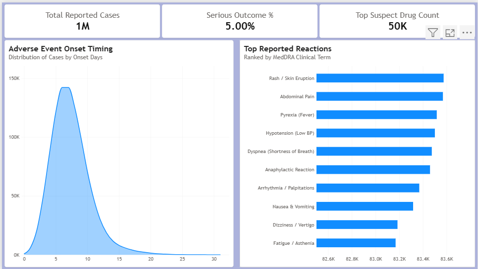
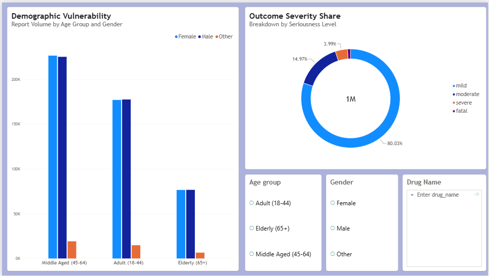

# Pharmacovigilance ADR Surveillance Dashboard

## Project Overview
This project presents an end-to-end Pharmacovigilance Adverse Event Reporting System (ADR) surveillance dashboard analyzing 1,000,000 post-market safety records. The pipeline processes raw adverse report logs, standardizes brand-to-generic drug entities using SQL, models relationships in Power BI, and visualizes trends across patient demographics and outcome severity levels.

---

## Tools & Technologies
- **Database Engine:** SQLite / PostgreSQL (DDL Scripts, Indexing, Data Normalization, `CASE WHEN` Entity Mapping)
- **Data Visualization & Analytics:** Power BI, DAX (Data Analysis Expressions), Relational Data Modeling (1-to-Many Star Schema)
- **Domain Standards:** Pharmacovigilance, Adverse Event Reporting (ADR), MedDRA Reactions, Patient Demographics

---

## Dashboard Visualizations

### Page 1: Executive Summary

- **KPI Header:** Tracks `Total Reported Cases`, `Serious Outcome %`, and `Top Suspect Drug Count`.
- **Adverse Event Onset Timing:** Continuous distribution curve evaluating time-to-onset (in days) from drug initiation to reaction manifestation, highlighting peak onset activity around days 5–7.
- **Top Reported Reactions:** Horizontal bar chart ranking the top MedDRA clinical reaction terms mapped directly from raw numerical codes (e.g., *Rash / Skin Eruption*, *Abdominal Pain*, *Pyrexia*).

### Page 2: Demographic & Outcome Breakdown

- **Demographic Vulnerability:** Comparative clustered column chart analyzing report volume across age groups broken down by gender.
- **Outcome Severity Share:** Donut chart categorizing event seriousness distribution by severity.
- **Interactive Slicers:** Dynamic filters for granular safety cross-filtering by `Age group`, `Gender`, and `Drug Name`.

---

## Technical Pipeline & Architecture

```text
[ FDA FAERS Dataset (1M+ Safety Reports) ]
               │
               ▼
   [ SQLite Data Engineering (ETL) ]
               │
               ├──> Step 1: Clean Raw Fields & Handle NULL Values
               ├──> Step 2: Patient Demographic Age Group Segmentation
               ├──> Step 3: Standardize Suspect Drug & Concomitant Therapies
               └──> Step 4: Map MedDRA Reaction Codes (`adr_code` -> `adr_term`)
               │
               ▼
     [ Power BI Star Schema Data Model ]
               │
               ├──> Fact Table (`Fact_ADR_Reports`) connected to Dimensions
               └──> Core DAX Measures (`_Measures`)
               │
               ▼
[ Interactive 2-Page Power BI Executive Safety Dashboard ]
```

---

## Key Safety Findings

 1. **Surveillance Scale:** Processed over 1 Million safety reports to monitor signal patterns across global post-market surveillance pipelines.
 2. **Time-to-Onset Signal:** The majority of reported adverse events manifest rapidly within 5 to 8 days following drug initiation, tapering off significantly after 15 days.
 3. **Most Frequent Reactions:** The top reported MedDRA terms are dominated by dermatological, gastrointestinal, and systemic reactions.
 4. **Severity Baseline:** 5.00% of reported outcomes represent serious or critical events (Severe or Fatal), providing an baseline metric for automated signal detection.

---

## Data Modeling & Architecture

The Power BI model is built on a clean Star Schema centered around Fact_ADR_Reports and linked to dedicated dimension tables via foreign keys:

* **Fact Table (`Fact_ADR_Reports`):** Central report logs containing `dosage`, `duration_days`, and `onset_days`.
* **Dimension Tables:**
 - `Dim_Patients`: Contains `patient_age`, `gender`, and calculated `age_group` categories.
 - `Dim_Drugs`: Normalizes `drug_name` and `concomitant_drugs`.
 - `Dim_Events`: Stores `adr_code`, `seriousness`, and the mapped MedDRA clinical term `adr_term`.
* **Measures Table (`_Measures`):** Centralized DAX measures including `Total Reported Cases`, `Serious Cases Count`, `Serious Outcome %`, and `Top Suspect Drug Count`.

---

## SQL Engineering Pipeline

All database normalization, age categorization, and MedDRA code mapping steps are executed in SQLite (`DB Browser for SQLite`).

The complete, reproducible ETL script is available in the repository root file:
📄 [ADR_Surveillance_script.txt](ADR_Surveillance_script.txt)

---

## How to Reproduce This Project

1. **Clone or Download the Repository:** Download or clone this project repository to your local computer.
2. **Database & SQL Pipeline:**
  - Unzip `raw_adr_data.zip` and `Fact_ADR_Reports.zip` inside the `Data/` directory.
   - Inspect the SQL script in [`ADR_Surveillance_script.txt`](ADR_Surveillance_script.txt) or review the processed CSV datasets.
3. **Explore the Power BI Dashboard:**
  - Open the `ADR_Surveillance.pbit` template file in Power BI Desktop.
  - When prompted, load or re-bind the data source path to your local CSV directory or SQLite database.

---

## 📁 Repository Structure
```text
├── Data/
│   ├── raw_adr_data.zip               # Raw Safety Registry Dataset
│   ├── Fact_ADR_Reports.zip           # Central Fact Table
│   ├── Dim_Patients.csv               # Patient Demographic Dimension
│   ├── Dim_Drugs.csv                  # Drug Name Dimension
│   └── Dim_Events.csv                 # MedDRA Event Dimension
├── ADR_Surveillance_SS/
│   ├── Page1_Executive_Summary.png    # Page 1 Visual Capture
│   └── Page2_Demographics.png         # Page 2 Visual Capture
├── ADR_Surveillance_script.txt        # Complete SQL Pipeline Script
├── ADR_Surveillance.pbit              # Interactive Power BI Report
└── README.md                          # Executive Documentation
```
